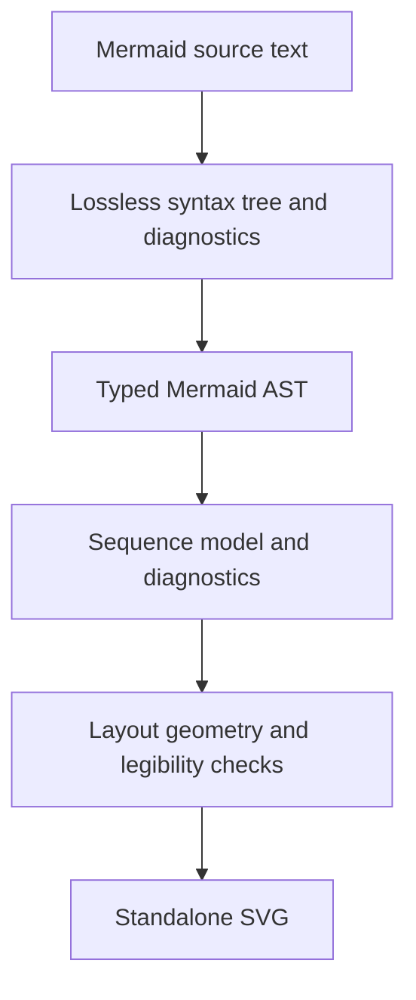

# Design overview

diagrams.mbt reads Mermaid sequence diagrams and renders standalone SVG. The
library has one format-independent model for each diagram kind. Sequence is
the first kind. Other kinds and formats need separate changes.

## One diagram, start to finish

| Step | Contract |
| --- | --- |
| Read | Keep every source character in a lossless syntax tree. Report errors with UTF-16 spans and continue reading. |
| Print | Write canonical Mermaid from the typed AST. Reading it again gives an equal AST. |
| Convert | Build an immutable sequence model with participants and ordered events. Report semantic errors. |
| Lay out | Measure labels and place participants, messages, notes, frames and activations. Check fit, overlap, text size and contrast. |
| Render | Write deterministic standalone SVG with adaptive or fixed dark and light colours. |

## One model per diagram kind

A sequence diagram needs message order, participant lifetimes, activations and
nested frame sections. A generic nodes-and-edges model would lose those facts.
Later sequence formats will produce the same `Sequence` model. A later
flowchart format will need its own model.

The format AST stays separate from the model. It keeps Mermaid spelling for the
canonical printer. The sequence model keeps the meaning that renderers need.
The `Renderer` trait takes a `Diagram` value and returns output, a media type
and diagnostics. Its current diagram case is `Sequence`.

## Links and render properties

A participant or message can link to a represented item through a scheme and
target. The model stores a Smithy shape in its normal `namespace#Shape` form.
Mermaid text uses `namespace/Shape`, because `#` starts a Mermaid comment.
Render properties hold presentation information such as a kind, sublabel and
description. Link resolution is a separate pure operation. The built-in Smithy
and OpenRPC resolvers are future work.

## Packages and boundaries

| Module | Responsibility |
| --- | --- |
| `moonrockz/diagrams` | Immutable models, diagnostics, link contracts and the renderer trait |
| `moonrockz/diagrams-mermaid` | Syntax tree, AST, canonical printer, model conversion and the SVG convenience call |
| `moonrockz/diagrams-svg` | Layout geometry, legibility checks and standalone SVG painting |

Library code is pure over explicit inputs and builds on `wasm`, `wasm-gc`, `js`
and `native`. Process and filesystem access stay in host adapters. The published
modules have no user interface.

See [Mermaid sequence diagrams](../guides/mermaid-sequence.md) for a rendered
example and the tested package guides for the API.
