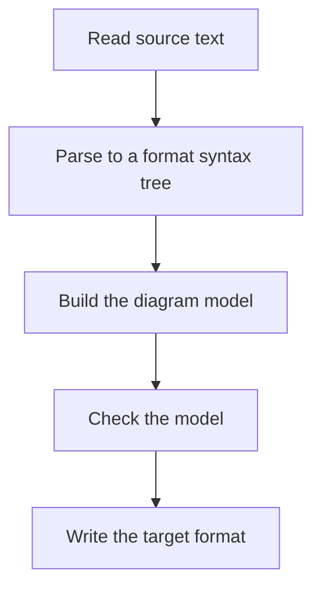

# Design overview

diagrams.mbt gives MoonBit a library for diagrams. It supports formats such as
Mermaid, PlantUML, Draw.io and Graphviz DOT. This page describes the proposed
design.

> [!NOTE]
> This page describes a proposed design. The API does not exist yet, so the code
> examples are not compiled. User docs come with each change as it lands.

## One diagram, start to finish

A program reads diagram text in one format, works on a typed diagram model, and
writes the model in the same format or in another one.

```moonbit notest
// Read Mermaid text, then write it as Graphviz DOT.
fn convert(source : String) -> String raise {
  let diagram = @diagrams.read(Mermaid, source)
  @diagrams.write(Dot, diagram)
}
```

The library does these steps in this order:



| Step | What happens |
| --- | --- |
| Read | Parse the source text of one format. Keep the source for reproduction. |
| Model | Build an immutable value with nodes, edges and labels. |
| Check | Report structured findings, such as an edge to a missing node. |
| Write | Write deterministic text for the target format. |

## Design principles

- Domain logic is pure over explicit inputs and immutable public values.
- Library code builds and tests on the `wasm`, `wasm-gc`, `js` and `native` targets.
- Process and filesystem access stay in host adapters.
- The published library has no user interface.
