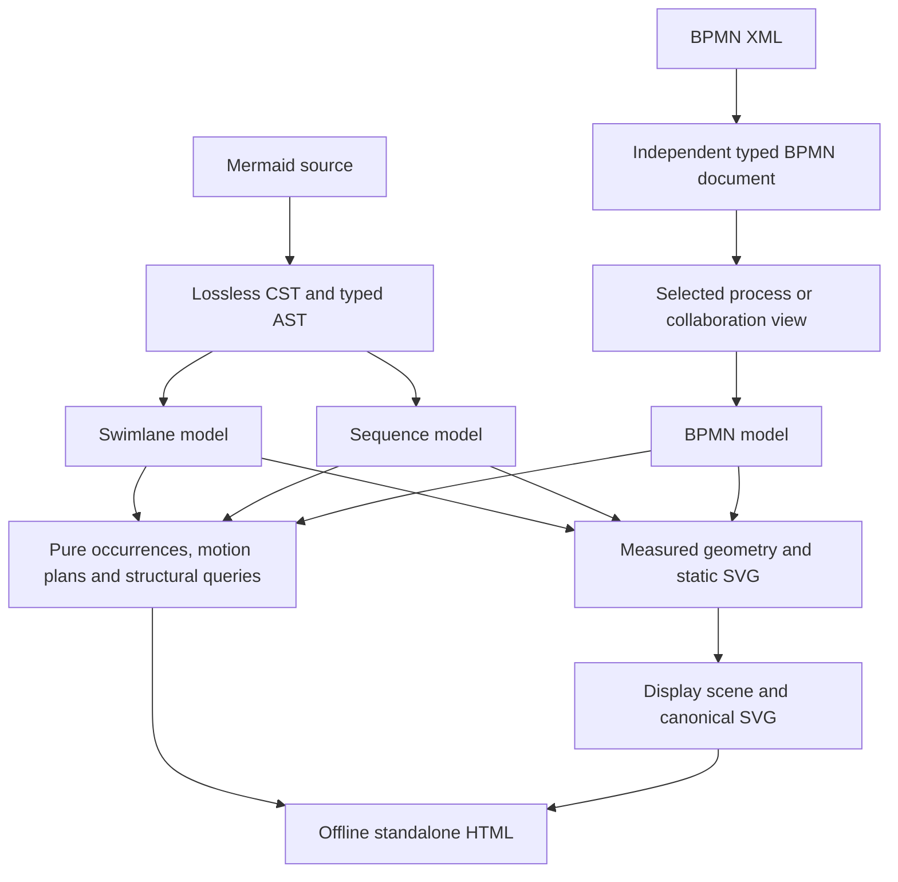

# Design overview

diagrams.mbt reads Mermaid sequence and native swimlane syntax and BPMN XML. Format-specific readers
produce immutable diagram models. SVG rendering and pure motion planning share
those models. Host adapters own process, filesystem and browser access.

## From source to output

A BPMN document retains processes, collaborations, choreography, conversations,
diagram interchange and vendor extensions. Its reader, writer, validation,
references and traversal work independently of diagrams and rendering. Resource
resolution accepts explicit inputs and performs no implicit I/O.

The BPMN adapter selects one view and preserves source identities and ownership.
Processes and collaborations render first. Choreography and conversation
rendering is explicitly deferred. Supplied DI keeps its exact coordinate tokens;
automatic layout uses bounded routing and reports exhausted limits.

## One model per diagram kind

Sequence diagrams retain message occurrence order, participant lifetimes and
nested frames. BPMN views retain typed nodes, connections, markers and scope.
Swimlanes retain ordered responsibility bands, nested groups, shapes and explicit
connections. Unowned steps stay outside lanes; containment never creates a path.
A generic graph would lose those distinctions. `Renderer` takes the public
`Diagram::Sequence`, `Diagram::Bpmn` or `Diagram::Swimlane` case and returns output, media type and
diagnostics. Adding a kind requires callers with exhaustive matches to add a case.

Links identify represented items, such as Smithy shapes or OpenRPC methods.
Render properties hold presentation metadata separately. Link resolution is pure;
the built-in Smithy and OpenRPC resolvers remain future work.

## Static and animated output

Ordinary SVG is complete, deterministic and script-free. Existing sequence SVG
bytes remain unchanged. A separate display scene uses the same measured geometry
and adds invisible scoped path bindings. Canonical SVG export excludes those
bindings, motion and selection state.

Motion plans are immutable values over explicit durations, order, repetitions
and concurrency. Sampling takes elapsed time as an argument. Only the generated
browser runtime reads a clock or DOM. Its offline controls respect reduced motion,
hidden pages and print output. Structural routes and illustrative flow do not
evaluate conditions, schedule timers, synchronize gateways or simulate tokens.

## Modules and boundaries

| Module | Responsibility |
| --- | --- |
| `moonrockz/bpmn` | Independent XML CST, typed documents, writing, validation, explicit references and traversal; MoonBit core only |
| `moonrockz/diagrams` | Immutable sequence/BPMN/swimlane models, diagnostics, links, renderer contract and pure motion/exploration |
| `moonrockz/diagrams-mermaid` | Mermaid CST/AST, canonical printing, sequence/swimlane conversion and SVG convenience call |
| `moonrockz/diagrams-bpmn` | BPMN view selection, document conversion and SVG convenience call |
| `moonrockz/diagrams-svg` | Geometry, bounded layout/routing, legibility, static painting and scene bindings |
| `moonrockz/diagrams-animated` | Pure standalone HTML construction with reproducibly embedded browser assets |

All libraries build and test on `wasm`, `wasm-gc`, `js` and `native`. They have no
UI framework. Only the unpublished docs site tool may use Rabbita. Publication
and release require separate owner approval.

See [Mermaid sequence diagrams](../guides/mermaid-sequence.md),
[Mermaid swimlanes](../guides/mermaid-swimlanes.md),
[BPMN and animation](../guides/bpmn-and-animation.md), and the tested package guides.
