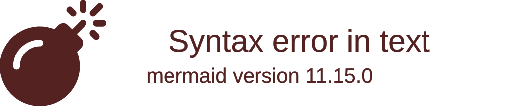

# Mermaid architecture diagrams

The native Mermaid reader accepts `architecture-beta` using the pinned Mermaid
12.2.0 grammar. Reading, conversion, layout and SVG writing work on wasm, wasm-gc,
JavaScript and native. Mermaid is a test reference only.

Use `read_diagram`, `print_diagram`, `to_architecture` and `render_svg` from
`moonrockz/diagrams-mermaid`. Sequence-only entry points keep their previous
meaning. The CST retains exact source, including invalid statements, UTF-16
positions, comments, CRLF, directives and front matter. The AST has typed group,
service, junction, edge and alignment statements. Canonical printing reads those
fields, so caller edits do not restore saved source text.

Conversion retains declaration order inside each model collection. The pinned
reference first registers groups in their declaration order, then services and
junctions, then connections and alignments. A child group therefore needs its
parent group declared earlier. A service may refer to a group that appears later
in source. Diagnostics identify missing/duplicate IDs, invalid group parents,
group-boundary attachments and alignment members. Errors prevent successful
source-to-SVG output. Reader limits are separate from existing swimlane limits.

An endpoint retains its service or junction ID, side and group-boundary flag.
`{group}` attaches the path beside that service on its containing group's outline.
It does not replace the service identity with a group ID. Parallel connections
have separate ordinal identities. Either endpoint can have an arrowhead.
`align row` keeps members on a horizontal axis in the listed order; `align column`
keeps members on a vertical axis. These constraints can span groups.

`moonrockz/diagrams/architecture` contains immutable constructors. Collections
are copied on construction. `validate` reports invalid models with bounded
ownership traversal. `moonrockz/diagrams-svg/architecture-layout` exposes pure
`layout` and `check` operations. Layout resolves ordered axis constraints,
measures labels and groups, then routes orthogonal paths around nodes and group
titles. Disconnected nodes use stable declaration order inside their ownership
container. Conflicting constraints, work exhaustion and coordinate exhaustion
have separate diagnostics. A failure returns no partial geometry or SVG.

The five bundled icons are `cloud`, `database`, `disk`, `internet` and `server`.
Quoted service icon text stays escaped text. Unknown icons retain the authored
name and show a visible labelled fallback with `architecture/unknown-icon`.
Source configuration is retained and warned about. It does not supply scripts,
CSS, icon packs or layout execution.

`SvgRenderer` accepts `Diagram::Architecture`, explicit architecture limits,
fixed dark/light palettes, adaptive output and an ID prefix. Output is standalone
`image/svg+xml` with accessible title and description, inline used-symbol
geometry and no network or font dependency. The public legibility checker
examines overlap, label fit, containment, authored endpoints, minimum text size
and contrast. It allows intended parent/child containment.

`AnimatedRenderer` uses the same canonical SVG and shared offline controls.
Playback starts still and illustrates authored connections. It does not assert
that a service ran or a deployment occurred. Catalog entries retain services,
junctions, groups and distinct connection identities. Route queries follow
arrowhead direction. Bidirectional connections permit either direction and
retain the traversal direction in playback. Unheaded connections require an
explicit `Undirected` query kind or the player's unheaded-connections checkbox.
Groups and alignments create no graph edges. Download during playback returns
the canonical static SVG.

Consumers that exhaustively match public enums must add
`ParsedDiagram::Architecture`, `DiagramTree::Architecture`,
`Diagram::Architecture`, `OccurrenceKind::Architecture`, architecture graph node
and edge kinds, and `NodeBindingKind::Architecture`. Existing constructors and
static outputs keep their previous behavior.

The compatibility corpus is in `tests/architecture-corpus/`. Its reference JSON
comes from the locked Mermaid database, not this converter. The reference
harness also checks canonical output with the upstream parser. Generated
portable fixtures and SHA-256 checks run through the MoonBit mise tasks.

Compare the architecture example in
[light](/assets/examples/architecture-cloud-light.svg) and
[dark](/assets/examples/architecture-cloud-dark.svg), read the
[native source](/assets/examples/architecture-cloud.mmd), or open the
[offline player](/assets/examples/architecture-cloud-light.html). Select a
connection, explore its arrow direction or enable unheaded connections.
Downloaded SVG keeps the canonical geometry and symbols during playback.

The [aligned grid](/assets/examples/architecture-grid-light.html) keeps row and
column constraints across three groups. The
[group-boundary example](/assets/examples/architecture-group-boundary-light.html)
keeps service endpoints while routing paths to their groups' outlines.
