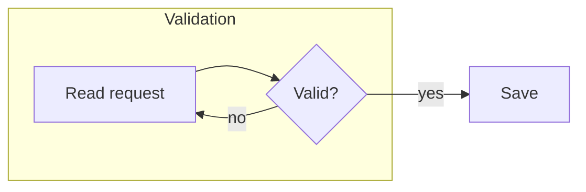

# Mermaid flowcharts

Read Mermaid `flowchart`, `graph` and `flowchart-elk` source through
`moonrockz/diagrams-mermaid`. Compatibility follows the pinned Mermaid 12.2.0
grammar and database semantics. Source processing and SVG output work without
upstream JavaScript on wasm, wasm-gc, js and native.

The root `read_diagram` API returns `ParsedDiagram::Flowchart`. Its syntax tree
reproduces every source code unit, including comments, front matter, directives,
CRLF and malformed regions. The typed AST keeps the header and shared grammar
statements. `print_diagram` writes typed values canonically; reading the result
preserves the logical AST. Existing sequence-only `read`, `print`, `ReadResult`
and `to_sequence` retain their types and behavior.

`to_flowchart` returns an immutable `moonrockz/diagrams/flowchart` model and
conversion findings. A source such as this keeps `Validation` as an ordinary
group, with no responsibility lane:

Implicit nodes, repeated declarations, grouped endpoints, parallel edges,
subgraphs, local direction, shape metadata and edge markers follow pinned
Mermaid rules. Top-level subgraphs remain groups. `swimlane-beta` still has its
separate responsibility-lane policy. Diamond shape alone does not assign a
process-execution role. Source bindings on converted node and connection
occurrences identify their original statements.

`render_svg` dispatches flowchart source to the shared SVG renderer. The model
also works directly with `Diagram::Flowchart`, public layout/legibility checks,
shared adaptive/fixed themes and SVG scene bindings. It supports the pinned
built-in vector shapes. Asset-dependent shapes retain their identity and return
explicit rendering errors when unsupported. No image URL is fetched.

Class/style declarations, callbacks and renderer configuration survive source
printing. Conversion reports unapplied presentation settings. URL click
statements retain model links, subject to the shared renderer link policy.
Callbacks never execute, and `flowchart-elk` does not load an external engine.

The usual animation API accepts the flowchart model. Its standalone player
provides finite illustrative plans, caller-selected branch/loop repetitions,
concurrent scenario groups, node visits, route/reachability inspection and
keyboard-accessible playback controls. Reverse and bidirectional traversal
follow edge markers. Unheaded edges require explicit undirected exploration;
invisible layout edges and note attachments do not create routes. Collapsed
descendants are outside the visible query scope. Results describe structure,
not executable paths or evaluated conditions. The offline player respects
reduced motion and hidden pages and downloads canonical static SVG.

Consumers that exhaustively match `ParsedDiagram`, `DiagramTree`, renderer
`Diagram` or scene node-binding kinds must handle the new flowchart cases.
No source-to-source conversion between Mermaid and PlantUML is provided.

Run `mise run validate:flowchart-mermaid-corpus` for frozen input/digest,
documentation, grammar and portable embedding checks. Run
`mise run flowchart-mermaid-corpus:reference -- --check` for the independent
pinned Mermaid source/canonical oracle. The committed corpus covers all 114
flowchart documentation examples, the shared grammar and shapes, and 148
accepted graph fixtures plus three recorded upstream refusals. Normal tests use
committed reference data without a browser or network.

Reader and printer `nodes` limits count AST node-declaration and group records;
`edges` limits count AST link records. A repeated node spelling still has a
separate declaration record. Conversion applies the same fields to normalized
distinct elements and expanded connections. Thus a grouped edge can fit one AST
link while exceeding its converted edge budget. Exhaustion preserves the source
tree and returns no complete AST, model or printed output for the failed phase.
