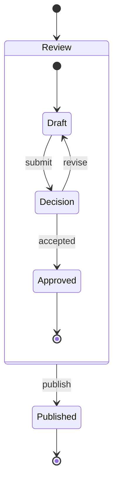

# Mermaid state diagrams

Read `stateDiagram` and `stateDiagram-v2` through the root
`moonrockz/diagrams-mermaid` API or its dedicated `state-syntax`, `state-printer`
and `state` packages. Compatibility follows Mermaid 12.2.0. Runtime processing
uses MoonBit only and supports wasm, wasm-gc, js and native.



`read_diagram` returns `ParsedDiagram::State` and `DiagramTree::State`.
`to_state` returns an optional immutable `moonrockz/diagrams/state.StateDiagram`
and diagnostics. A dedicated reader consumer needs these imports:

```moonbit
import {
  "moonrockz/diagrams-mermaid/state-syntax" @syntax,
  "moonrockz/diagrams-mermaid/state-printer" @printer,
  "moonrockz/diagrams-mermaid/state" @conversion,
}
```

The following path is checked by the fresh reader consumer on all four targets:

```moonbit
let source = "stateDiagram-v2\n[*] --> Idle\nIdle --> Running : begin\nRunning --> [*]\n"
let read = @syntax.read(source)
assert_eq(read.tree.text(), source)
let ast = read.ast.unwrap()
let canonical = @printer.print(ast).output.unwrap()
let model = @conversion.to_state(ast).state.unwrap()
assert_eq(model.transitions.length(), 3)
assert_eq(@printer.print(@syntax.read(canonical).ast.unwrap()).output, Some(canonical))
```

The source tree retains comments, directives, front matter, invalid statements,
CRLF and non-BMP text. Findings have stable codes and half-open UTF-16 spans;
lines and columns start at one. Recovery keeps later readable statements.
An `Invalid` AST statement prevents complete conversion and printing. Fatal
processing exhaustion returns no AST. Canonical printing uses typed statements,
so editing a label changes output. Repeated read and print have equal bytes.
Invalid or unrepresentable edits return findings and no output.

Aliases, implicit declarations, ordered descriptions, initial/final forms,
composites, `--` concurrent regions, choice/fork/join, notes and four directions
retain their native structure. Square-bracket role spellings such as
`[[choice]]` follow the same pinned semantics. Ordinary identifiers are global.
A later occurrence inside a composite updates its owner; a root reference keeps
an existing nested owner. Initial and final IDs use the owning region, such as
`Review::region-0::initial`. Equal labels with different identifiers remain
different states. Parallel transitions and self-loops keep separate IDs.

Pinned behavior resolves documentation disagreements. Cross-composite child
transitions are accepted by Mermaid 12.2.0 even though its state guide says they
are prohibited. The first occurrence fixes a state's role; a later role
redeclaration does not replace it. The first description supplies the heading,
and subsequent descriptions form ordered compartments. Composite nodes with
multiple descriptions are refused upstream. The reserved identifier `root`
produces incomplete upstream topology and receives an explicit native
`state/reserved-id` conversion error.

`--` is a concurrent separator inside composite bodies. A top-level separator
and arrows other than `-->` receive syntax errors. PlantUML-only history and
boundary stereotypes are not Mermaid roles. The pinned parser silently ignores
some unsupported `state` declarations; the native reader reports unsupported
role syntax instead of inventing a state. A plain `state A` without an alias,
body or supported role is retained as unapplied presentation, matching its
upstream omission from topology. Use `A` to declare an ordinary state.

Classes, styles, clicks, scale, hide commands, directives and source configuration
remain inert data. Conversion reports unapplied presentation. Floating notes
are accepted but omitted by the pinned renderer; native inspection retains them
with a finding. Labels remain literal text, including markup-like labels that
upstream sanitizes. Standalone SVG escapes that text. No callback, guard, action,
asset request or source-selected renderer executes.

`Limits` has explicit `source`, `output`, `states`, `regions`, `transitions`,
`depth`, `diagnostics` and `work` fields. Reader state limits count declaration
records; conversion state limits count distinct states, including implicit
endpoints. Region limits include the root. Bounds apply before excess expansion,
and exhaustion never returns successful partial output. Source and syntax
findings use `state/` codes; conversion also reports structural model findings.

`render_svg` uses the shared state SVG renderer. Constructed models also work
with `Diagram::State`, SVG scenes, geometry checks and the shared offline player.
Playback illustrates finite occurrences and caller-selected scenarios. It does
not evaluate guards, execute actions, restore history or compute an active state
configuration. See [state models and playback](states-and-animation.md).

Consumers with exhaustive matches must add `ParsedDiagram::State`,
`DiagramTree::State` and renderer `Diagram::State`. Existing sequence-only
`read`, `print`, `ReadResult` and `to_sequence` retain their contracts.

Run these checks from the repository root:

```shell
mise run validate:state-mermaid-corpus
mise run state-mermaid-corpus:reference -- --check
mise run test:state-consumer
mise run test:state
```

The committed corpus freezes all 22 state documentation diagrams, grammar and
semantic source files with MIT notices and SHA-256 digests. Its feature inventory
separates supported constructs, literal data, inert presentation, native refusals
and upstream refusals. The pinned reference independently projects states,
regions, ownership, pseudostate roles, transitions and notes from Mermaid's
database and checks original and canonical source. Portable acceptance tests
consume committed JSON without a browser or network. Reference refresh uses the
existing locked test-only Mermaid and Chromium installation.
