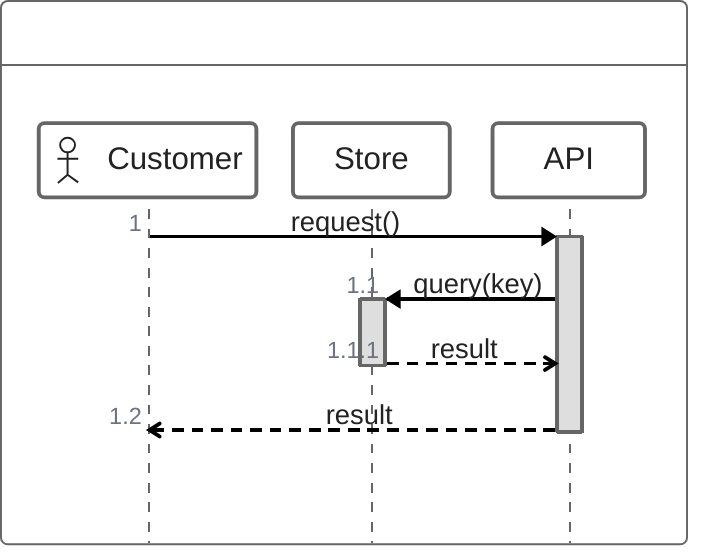

# Mermaid ZenUML

Read Mermaid `zenuml` source with the general Mermaid API. Conversion produces
an ordinary sequence model, so static rendering, structural playback and offline
SVG export use the same contracts as sequence diagrams.

The compatibility profile uses Mermaid 12.2.0 documentation and the exact
`@mermaid-js/mermaid-zenuml` 1.0.1 / `@zenuml/core` 3.47.9 reference. The native
reader supports participant declarations and aliases, annotators, synchronous
and asynchronous messages, creation, assignments, nested calls, returns,
comments, loops, alternatives, optional and parallel bodies, and exception
sections. Headerless source and other editor extensions are outside this profile.
Unsupported statements remain in the lossless syntax tree and get diagnostics.

`read_diagram` selects `ParsedDiagram::Zenuml` and `DiagramTree::Zenuml` for the
`zenuml` header. The sequence-specific `read`, `print` and `to_sequence` APIs keep
their existing contracts. Use `to_zenuml_sequence` to convert a ZenUML AST, or
`render_svg` for the source-to-SVG path. The separate `zenuml-syntax`,
`zenuml-ast`, `zenuml-cst`, `zenuml-printer` and `zenuml` packages provide direct
reader, typed syntax, reproduction, printing and conversion APIs.

The AST keeps typed statements and explicit scope boundaries. `Call` keeps its
sender, receiver, operation text, assignment, creation flag and body flag.
`Begin`, `Section` and `End` preserve nested fragment boundaries. Printing uses
these fields, so edits to aliases, methods, conditions and section order appear
in canonical output. `tree.text()` reproduces the complete original input,
including malformed text, comments, front matter, directives and CRLF endings.
Source spans use half-open UTF-16 offsets and one-based lines and columns.

An implicit caller uses `_STARTER_` with actor appearance. `@Starter(User)`
selects an explicit caller. Calls produce a message and balanced activation
boundaries. A call body makes the receiver its current caller. Assignments add
a dotted reply labelled with the result variable. Expressions remain text.
`return` targets the enclosing caller; a return without a valid caller fails
conversion. `@return` and `@reply` preserve explicitly authored reply endpoints.
Creation starts the new participant's lifeline on its creation row. Attached
comments become notes before messages and fragments. Markdown stays safe text.

All 523 annotator keys from the pinned `LazyIcons.ts` registry resolve to compiled
inline vectors. This includes UML, AWS, Azure, Google Cloud, application and
technology symbols. The complete coverage list is the pinned participant
registry, rather than upstream's smaller static SVG table. Names use upstream's
ASCII case folding. A participant stores its namespaced `icons.Reference`
independently of its semantic kind. Render-property overrides preserve the icon.
Only used symbols enter an SVG, and repeated symbols share local definitions.
Custom ID prefixes isolate inline copies. Provider colours have a white backing
plate in both themes. Asset source digests, normalized digests, licences and
attributions accompany the catalog under `pkgs/diagrams-svg/icons`.

Unknown annotators keep their identity. They produce
`zenuml/unknown-annotator` and `svg/unknown-icon` warnings, show a generic symbol
and the unresolved name, and never request network resources. Known annotators
always render their registered art.

A try frame has ordered sections whose `SectionRole` is `Try`, `Catch` or
`Finally`. Existing section constructors default to `Plain`. All sections are
visible in static output. A scenario uses
`Choice::ExceptionSections(ReadOnlyArray[Int32])` to select the source-ordered
sections it illustrates. The planner requires that choice and includes a
finally section only when the caller selects it. Playback never infers an
exception outcome or runs source expressions. The default illustration can show
all authored structure without asserting execution.

Direct readers, converters and printers accept `zenuml-syntax.Limits`. Defaults
are 16,777,216 source/output units, 10,000 participants, 50,000 events, depth 256,
256 diagnostics and 1,000,000 work units. Limits apply before a complete output
is accepted. Invalid or exhausted limits and syntax/semantic errors suppress a
successful SVG; warnings preserve usable output. Source metadata stays data and
gets `zenuml/presentation-metadata` warnings when rendering options are ignored.

Diagnostics have stable `zenuml/` codes. Reader findings include `header`,
`identifier`, `call`, `starter`, `unsupported-statement`, `expected-brace`,
`unexpected-brace`, `missing-brace`, `unterminated-string`, `unclosed-expression`, `diagnostic-limit`, `participant-limit`,
`event-limit`, `source-limit`, `depth-limit` and `work-limit`. Converter findings
include `participant-conflict`, `starter-collision`, `return-target`, `section`,
`nesting`, `limits` and the shared count/work limits. Printer findings include
`invalid-ast`, `nesting`, `output-limit`, `depth-limit` and `work-limit`.

Consumers with exhaustive matches must add `Zenuml` to parsed/CST matches,
`Try` to `FrameKind`, the section roles and `ExceptionSections` to playback
choices. Architecture adds its own parsed/model/animation cases. Existing
participants have no explicit icon and retain their prior geometry. Existing
sequence, BPMN and swimlane static snapshots remain unchanged.

The independent fixture oracle and canonical upstream acceptance check are in
`tests/zenuml-corpus/reference`. Acceptance snapshots cover nested calls,
creation, returns, multi-catch/finally, symbol identity, legibility, isolated
inline copies and offline-player artifacts on all four targets.

Compare the annotated interaction in [light](/assets/examples/zenuml-symbols-light.svg)
and [dark](/assets/examples/zenuml-symbols-dark.svg), or read its
[native source](/assets/examples/zenuml-symbols.mmd). Open the
[offline player](/assets/examples/zenuml-symbols-light.html) to inspect symbols,
step through calls and download the canonical static SVG. The
[exception scenario](/assets/examples/zenuml-exceptions-light.html) selects the
try section, one catch and finally explicitly; the other catch remains visible.
The gallery includes the complete symbol contact sheet. See the
[asset notices](https://github.com/moonrockz/diagrams.mbt/blob/main/pkgs/diagrams-svg/icons/NOTICE.md)
for source digests, attribution and provider terms.
