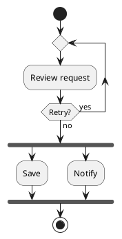

# PlantUML flowcharts

The PlantUML module reads modern and legacy activity diagrams inside one
`@startuml` block. Both dialects convert to the shared flowchart model and use
its themed SVG, structural route queries and offline player. The compatibility
baseline is PlantUML **1.2026.9**.



Use `moonrockz/diagrams-plantuml` to read a block, inspect diagnostics, write
canonical source and convert its typed document. `Document::Activity` contains
an editable `moonrockz/diagrams-plantuml/activity.Document`. Its dialect is
`Modern` or `Legacy`; its statements contain typed control values and source
spans. `tree.text()` reproduces the original source, including invalid regions.
Recoverable activity errors can retain a partial document. Check diagnostics
before conversion; the SVG convenience operation returns no output on errors.
`plantuml.print` writes a complete block from the typed values. The body printer
writes only the body. Canonical equality ignores source spans and trivia.

For an explicit body call, use `read_body(Activity, body, dialect=Modern)` or
`dialect=Legacy`. The generic block reader selects the dialect from activity
statements. Strings, comments and notes do not select a dialect. Other UML
families and unsupported mixed dialects give errors.

## Syntax and model

Modern syntax includes actions and lists, final forms, if/elseif/else,
switch/case, repeat/backward/break, while, fork/end fork/end merge, split,
kill/detach, connectors, label/goto, partitions, groups, lanes and notes.
Legacy syntax includes quoted or bare activities, aliases, implicit previous
activities, directional arrows, branch controls, synchronization bars,
partitions and notes. Nested constructs retain their order and source bindings.

Modern equal-label actions are separate occurrences. Legacy aliases and repeated
activity names follow PlantUML's reuse rules. Generated IDs use deterministic
source order and avoid authored names. Do not use labels as occurrence IDs.

PlantUML partitions remain nested groups. Pipe declarations create explicit
responsibility lanes. A partition can span several lanes. A note attaches to
its declared node or connection and does not become a control-flow edge.
`note on link` uses the connection identity in the model's separate connection
attachment namespace.

Legacy `endif` does not create an implicit merge. An arrow without a source
after `endif` starts at the last active branch action, as the pinned reader
does. Use explicit aliases and arrows when both branch tails must reach one
common action. Direction hints such as `-up->` and `-left->` remain separate
from the connection's authored source and target.

## Rendering and playback

Convert with `to_diagram` and pass the resulting `Flowchart` variant to the
shared SVG or animated renderer. The model retains actions, decisions, merges,
forks, joins, starts, distinct final forms, branch labels and loop regions.
The source grammar stays in the reader module; the immutable model has no
PlantUML runtime or UI dependency.

SVG uses the library's vector symbols and adaptive or fixed light/dark themes.
It does not reproduce PlantUML's coordinates or skins. Source styles and colors
remain printable data and produce findings when the renderer does not apply
them. External images produce `activity/external-asset` during conversion.
The library does not load files, use Java, call Graphviz or make network requests.

Animation illustrates structure. Default plans are finite, including cyclic
models. Explicit scenarios choose occurrences, loop repetitions, durations and
concurrent groups. Routes follow declared connections; they do not evaluate
conditions, execute actions or synchronize workflow tokens. The offline player
uses the existing controls, keyboard access, reduced motion, hidden-page and
print behavior. SVG download excludes playback overlays and retains the direct
static rendering.

## Compatibility evidence

The frozen corpus in `tests/corpus/plantuml-activity` contains every unique
example from the captured modern and legacy documentation pages and independent
branch, loop and parallel fixtures. `provenance.json` identifies the pages,
upstream source commit and licenses. `SHA256SUMS` binds all inputs and metadata.
The feature/refusal records distinguish native behavior and library limits.

The test-only Java adapter reads PlantUML's modern instruction tree and legacy
ordered entities and links directly. It does not use MoonBit conversion to
construct expected values. Source and canonical output are both checked against
the pinned JAR. Two documentation examples repeat `@enduml`; the library reports
that trailing marker under its existing single-block contract. External-image
examples remain readable and printable but conversion refuses asset loading.

Run these commands from the repository root:

```sh
mise run activity-corpus:reference -- --check
mise run activity-corpus:generate
mise run validate:activity-corpus
```

Only the reference task needs the pinned JAR and JDK. Normal acceptance tests
read committed reference data on wasm, wasm-gc, js and native.

Adding `Activity` and `Flowchart` variants requires downstream exhaustive
matches over PlantUML document/kind values and the shared renderer enum to
handle those cases. Existing regex, EBNF, JSON and YAML entry points keep their
contracts.
