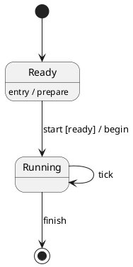

# PlantUML state diagrams

`moonrockz/diagrams-plantuml` reads native state diagrams against the pinned
PlantUML `1.2026.9` profile. It keeps the source tree and an editable typed AST,
then converts the AST to `moonrockz/diagrams/state` values. Parsing and conversion
perform no I/O and run on wasm, wasm-gc, js and native.



Descriptions, labels, guards and actions are text. They do not execute. Internal
behavior descriptions add no transition. History references retain their owning
composite and history role. They do not restore a previous state.

## Read, edit and print

Import the full `moonrockz/diagrams-plantuml` package for automatic block selection,
printing, model conversion and SVG rendering. `read` recognizes one complete
`@startuml`/`@enduml` block with explicit state evidence. A bare `A --> B` UML body
is ambiguous. Call `read_body(State, body)` when the caller knows its family.
Activities still require their explicit dialect when reading a body.

The dedicated `moonrockz/diagrams-plantuml/state` package imports the model,
source tree and envelope packages. It has no renderer dependency. Its `read`
accepts an `@envelope.Scan`; `to_state` returns an optional state model and
findings. The following example is checked in the package documentation.

```moonbit
let scan = @envelope.scan("@startuml\nstate Ready\nReady --> Done : finish\n@enduml\n")
let read = @state.read(scan)
let document = read.document.unwrap()
let model = @state.to_state(document).state.unwrap()
assert_eq(model.transitions[0].source, "Ready")
assert_eq(model.transitions[0].target, "Done")
```

`Document.items` contains typed declarations, descriptions, transitions, composite
opens/closes, separators, notes, direction and retained presentation values.
`Statement.explicit_label` preserves whether a declaration supplied an explicit
alias label. This affects pinned composite redeclaration behavior and therefore
stays in canonical output. Composite declarations retain their identity when
redeclared. Leaf roles follow their first declaration while later labels update.
`Document::new` copies the supplied statement array. To edit a label,
replace its typed `Transition(from, arrow, target, label)` value and print the new
document. `print_body` returns a body. The full package's `print(State(document))`
adds the UML envelope and retained metadata. Printing checks representability,
so invalid values return findings and no output. A second read/print has equal
bytes. Printing uses the edited AST rather than replaying the original text.

The lossless tree reproduces comments, invalid lines, CRLF and non-BMP text.
Findings use half-open UTF-16 spans and one-based lines and columns. Recovery
keeps later valid statements, but sets `Document.complete` to false. Incomplete
recovery documents cannot convert or print as successful complete diagrams.

## Compatibility and identity

The profile supports declarations, both quoted-alias orders, qualified names,
implicit states, redeclarations and ordered descriptions. Composites include
empty and nested forms; `--` and `||` retain concurrent region orientation.
Transitions preserve parallel edges, self-loops, arrow direction hints, line
styles and endpoint markers. Left/up drawing hints do not reverse semantic
endpoints. Reverse arrows retain their authored semantic direction.

State roles distinguish initial, final, choice, fork, join, shallow/deep history,
entry/exit points, input/output pins and expansion input/output symbols. Scoped
`[*]`, `[H]`, `[H*]` and composite history targets have deterministic identities.
Unqualified cross-composite names follow the pinned resolver. Concurrent regions
retain the reference's distinct `CONC` source scopes. Region containers never
become route edges. Note attachments may target states or the preceding link;
floating notes have their own identity.

Colors, stereotypes, skin parameters, style blocks, titles and mainframe
presentation stay inert. Library themes and caller options control rendering.
Findings identify unapplied presentation. The `sdlreceive` stereotype retains an
`Unsupported("sdlreceive")` role and receives an explicit rendering diagnostic.
Includes, executable preprocessing, images, external assets and links are refused
without reading a resource. Mixed JSON/state documents, frame groups and
multiple or nested UML blocks are outside this profile. All 45 frozen upstream
documentation examples have acceptance or explicit refusal records.

Public exhaustive matches must handle `Document::State` and
`envelope.Kind::State`, plus the shared `render.Diagram::State` case. Existing
regex, EBNF, JSON, YAML and modern/legacy activity entry points keep their
contracts. Text inside quotes, comments or notes does not select a UML family.

## Limits and qualification

`envelope.Limits::new` has positive `source`, `output`, `depth`, `nodes`, `regions`,
`edges`, `work` and `diagnostics` bounds. `nodes` bounds state values and typed
statements; `regions` bounds root, nested and concurrent regions; `edges` bounds
transitions. Invalid input uses syntax/structure findings. Exhaustion uses
`state/limit` or envelope source/diagnostic limit findings and gives no successful
complete model or printed output.

Run these commands from the repository root:

```shell
mise run state-plantuml-corpus:reference -- --check
mise run validate:state-plantuml-corpus
mise run test:state-consumer
mise run test:state
mise run gallery -- --qualify
```

The reference task uses the pinned JAR and JDK only in test tooling. It checks
original sources and canonical output by inspecting upstream entities, ownership,
roles, boundary positions, descriptions and ordered transition links. Expected
values do not come from the MoonBit converter or an SVG image. Ordinary tests
use committed fixtures and need no Java, Graphviz or network. The corpus records
provenance, licenses, source digests, adapter digest, accepted features and
library refusals under `tests/corpus/plantuml-state/`.
