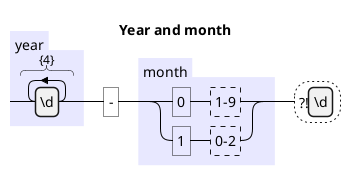
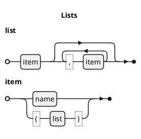
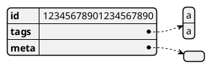
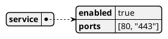

# PlantUML regex, EBNF, JSON and YAML

`moonrockz/diagrams-plantuml` reads four native PlantUML block types without
Java, a server or a network call. The behavior follows PlantUML `1.2026.9`
(commit `18d0aae311a4f1eb3723bb4b0ad939185e22f166`). Each block becomes a
format-independent model in `moonrockz/diagrams`; the same renderer, scenes and
offline player work for every kind.

The docs site renders `plantuml` and `puml` fences at build time. Ordinary
`json`, `yaml`, `regex` and `ebnf` fences stay code.

## Read, write and convert

The [PlantUML module guide](../../pkgs/diagrams-plantuml/README.mbt.md) has
compiled examples of `read`, `read_body`, `print`, `print_body`, `to_diagram`,
`render_svg` and `render_traced_svg`. The syntax tree reproduces every source
code unit, also for invalid input. Diagnostics have stable codes and half-open
UTF-16 spans. Canonical writing comes from typed values and is stable; a value
that the native syntax cannot express gives a diagnostic and no text.

| Kind | Model | Keeps |
| --- | --- | --- |
| Regex | `Regex` | Literals, classes, sets, anchors, backreferences, groups and names, lookarounds, alternatives, symbolic bounds and reluctant quantifiers |
| EBNF | `Grammar` | Ordered rules and notes, terminals, references, special sequences, options, repetitions, counts, exclusions and empty rules |
| JSON | `DataTree` | Member order, repeated names, exact number lexemes, strings, booleans, null and empty containers |
| YAML | `DataTree` | The native PlantUML subset; every scalar is text |

## Compatibility profile

A frozen corpus pins the native behavior: every PlantUML documentation example
for the four kinds, plus edge cases. The pinned JAR records what PlantUML does
with each fixture, and portable tests on all four targets compare the models
with that reference. Each difference is recorded with a reason.

| Category | Meaning | Examples |
| --- | --- | --- |
| Accepted | PlantUML and this library accept the input and agree | All other fixtures |
| Native refusal | PlantUML refuses it, and so does this library | `a{2,4}?`, `a|`, `(ab`, an EBNF rule drawn as "Syntax error!", malformed JSON, folded YAML `>` |
| Library refusal | PlantUML accepts it, but this library gives an error | Preprocessor directives and calls, two pattern lines, `\x41`, unclosed sets, text after the end marker, a wrong end marker, `n * x` with a non-decimal count |
| Divergence | Both accept it; the library keeps a different, documented meaning | `\Q...\E` read as quoted text, surrogate pairs kept whole, `\-` in a set, `/` inside a quoted highlight segment, `!option` labels not applied |

Presentation commands such as `skinparam`, `<style>`, `caption` and `!option`
stay in the AST as inert values with a warning. Library themes paint the
diagram. Includes, definitions, themes and preprocessor calls never run; they
give errors. No reader does file, process or network I/O.

## Static views

Compare the [regex example](/assets/examples/regex-date-light.svg) with its
[dark copy](/assets/examples/regex-date-dark.svg) and
[source](/assets/examples/regex-date.puml), and the
[EBNF example](/assets/examples/ebnf-arithmetic-light.svg),
[JSON example](/assets/examples/json-order-light.svg) and
[YAML example](/assets/examples/yaml-service-light.svg).

Railroads keep constraints distinct: a lookaround is a dashed frame on the route
with its pattern inside, and an exclusion draws the excluded term in an "except"
frame below its left term. A recursive reference stays one term. A reference to
a missing rule has a dashed outline and a warning. Data boxes keep member order
and array positions; nested containers are separate boxes with one connector,
and scalars stay in their row.

## Match and parse evidence

The library has no regex matcher or grammar parser. An external engine can
implement `RailroadTraceProvider` and return a trace: attempts with term visits,
connector traversals, optional input spans and failure points. The renderer
draws four independent channels:

| Channel | Shows |
| --- | --- |
| Matched | The paths of attempts that matched |
| Not matched | The paths of attempts that did not match |
| Taken | The taken path or prefix of the selected attempts |
| Failure | The failure terminal, assertion or entry/exit boundary |

Compare [both outcomes](/assets/examples/regex-date-trace-success.svg),
[a failed attempt](/assets/examples/regex-date-trace-failure.svg),
[only the prefix](/assets/examples/regex-date-trace-prefix.svg) and
[only the failure terminal](/assets/examples/regex-date-trace-terminal.svg).
These examples use a scripted test provider. Unvisited branches stay neutral.
`Unsupported`, `Exhausted` and `ProviderError` results are not non-matches; they
give diagnostics and no SVG. A trace for another model, or for an older version
of the same model, gives an error.

## Playback and exploration

Open the [regex player](/assets/examples/regex-date-light.html),
[EBNF player](/assets/examples/ebnf-arithmetic-light.html) or
[JSON player](/assets/examples/json-order-light.html). Connector steps follow the
drawn paths. Node visits highlight a term, row or box without a path. Routes
follow drawn branch, bypass and return connectors; hierarchy routes use
containment only. Playback illustrates structure and never claims that an input
matches. Download SVG gives the canonical bytes, including configured trace
highlights.
