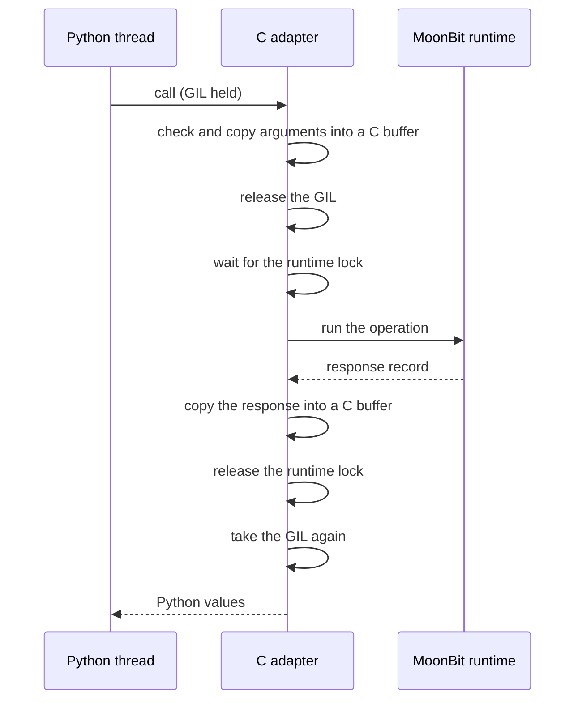

# Python threads and concurrency

You can call `diagrams_mbt` from any Python thread. The MoonBit code runs one
call at a time, and other Python threads continue while it runs.

## What is supported

| Use | Supported |
| --- | --- |
| Calls from different threads of one interpreter | Yes. MoonBit calls run one at a time. |
| Other Python threads run during a native call | Yes. The GIL is released. |
| Native calls that run at the same time (multi-core MoonBit work) | No. |
| Free-threaded CPython (`python3.13t` and later) | No wheel. The `abi3` wheel cannot load there. |
| Subinterpreters with their own GIL | No. The import fails with `ImportError`. |
| Recovery from a MoonBit panic | No. A panic stops the process. |

## How a call runs

The MoonBit runtime keeps process-wide state, for example its cycle-collector
buffers, and its reference counts are not atomic. So the extension has one
process-wide **runtime lock**, and every MoonBit operation runs inside it.

- The GIL is held only to read the arguments and to make the Python result.
- The wait for the runtime lock and all MoonBit work run without the GIL.
  Other Python threads run during that time, also threads that are not
  related to `diagrams_mbt`.
- The extension releases the runtime lock **before** it takes the GIL again.
  No thread waits for the GIL while it holds the runtime lock, and no thread
  waits for the runtime lock while it holds the GIL. So the two locks cannot
  deadlock.
- No Python code runs while the runtime lock is held: no callback, no
  finalizer and no Python API call. A finalizer or a callback that calls
  `diagrams_mbt` again is therefore safe.
- The runtime starts one time for each process, inside the runtime lock, when
  the first import runs. A second import makes a new module object but does
  not start the runtime again.

The lock is not fair. When many threads call at the same time, one thread can
wait for several calls of other threads. The runtime lock makes calls safe; it
does not make them faster. Do not expect more throughput from more threads.

## Release points

| Operation | GIL released | Runtime lock held |
| --- | --- | --- |
| `render_svg` | During the wait for the lock and during the render | During the render only |
| Reading arguments, building the `Rendered` value | No | No |

Operations that later versions add (BPMN traversal, queries) follow the same
rule: the GIL is released for each native step, and Python callbacks run
between native steps, outside the runtime lock.

## Busy errors

Some native objects change state, for example a cursor that moves through a
document. Such an object accepts one call at a time. When a second thread uses
the same object while a call is in progress, the second call does not wait: it
raises `diagrams_mbt._boundary.BusyError` (a `RuntimeError`, code `busy`).
Independent objects of the same kind stay usable at the same time.

The same rule applies when a callback of a traversal uses its own cursor
again.

## Memory allocator

The wheels link mimalloc for MoonBit memory only; Python keeps its own
allocator. mimalloc can call the runtime from other places, for example when a
thread that used the extension ends. The extension makes sure that these
calls do MoonBit work only on a thread that holds the runtime lock. See the
[feasibility report](https://github.com/moonrockz/diagrams.mbt/blob/main/apps/python-native/FEASIBILITY.md)
for the audit and the measurements.

## Limits

- A MoonBit panic calls `abort()` and stops the Python process. The extension
  cannot catch it. Use a separate process for untrusted input if that is a
  problem.
- Free-threaded CPython and subinterpreters with their own GIL are not
  supported. A future free-threaded wheel would need a new design.
- The extension does not use more than one CPU core for MoonBit work.
