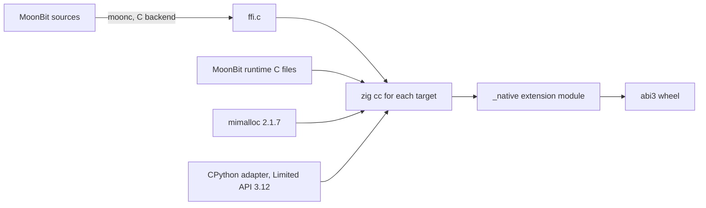

# How the Python package works

## From MoonBit to a wheel



1. `moon build --target native --release` writes C for the native
   `foreign_library` package `apps/python-native/ffi`. It exports two C
   functions: the boundary version and `diagrams_py_call`, which takes one
   encoded request record and returns one encoded response record.
2. `zig cc -target <target>` compiles that C, five MoonBit runtime files, the
   CPython adapter and mimalloc 2.1.7, the same version that the MoonBit runtime
   bundles. One Linux or macOS host builds all five wheels.
3. A small standard-library script writes each wheel with its metadata and the
   license files of the bundled components.

The Python wrapper turns the response values into dataclasses. It does not
parse or render a diagram itself.

## The private boundary

The boundary is private and has its own version (`diagrams_mbt.ABI_VERSION`,
now 2). The extension refuses a MoonBit library with another version with
`ImportError`. The version does not change with the package version.

A request is a tuple `(operation, arguments...)`. Values are `None`, `bool`,
64-bit `int`, `str`, `bytes` and tuples of them, nested at most 64 levels.
The C adapter writes them in a small binary record format: one tag byte, then
a little-endian integer, a length and UTF-8 text, a length and bytes, or a
count and the items. The response is `(0, value)` or `(1, code, message)`;
`diagrams_mbt._boundary` turns a failure into an exception class for its code.
Tuples come back as tuples.

`render_svg` sends the source as UTF-8 bytes and gets back
`(media_type, output, diagnostics)`. The SVG text is one UTF-8 string in the
response record. There is no JSON document and no second parse of the SVG.

Native objects that Python keeps, such as documents and cursors, are opaque
64-bit tokens. Each token has an object kind, a slot and a generation, and the
MoonBit side checks all three before it uses the object. A token of another
kind, an unknown token and a closed token raise distinct exceptions; none of
them reaches another object.

## Memory and calls

- The adapter copies the request into a C buffer while it holds the GIL, then
  into a new MoonBit `Bytes` value. It copies the response into a second C
  buffer before it releases the runtime lock, and makes the Python values from
  that buffer after it holds the GIL again. It releases each MoonBit value and
  frees each C buffer one time. No Python object points into MoonBit memory.
- The MoonBit runtime starts one time for each process, inside the runtime
  lock, when the module is imported. It stays until the process stops.
- All MoonBit work runs inside one process-wide runtime lock, without the GIL.
  See [Threads and concurrency](concurrency.md).
- The spike measured no leak with the macOS `leaks` tool after 4,000 renders,
  and no error with AddressSanitizer and UndefinedBehaviorSanitizer. See the
  [feasibility report](https://github.com/moonrockz/diagrams.mbt/blob/main/apps/python-native/FEASIBILITY.md).

## Tests

Each pull request builds the wheels with zig on Linux. Then it installs each
wheel on a native runner and runs the tests with CPython 3.12 and 3.15,
including the thread tests of the runtime lock:
Linux x86_64 and arm64, macOS arm64 and Intel, and Windows x86_64. The tests
compare the output and the diagnostics with the direct output of a native
MoonBit program. `auditwheel` checks the Linux tags and `twine check` checks
the metadata.

To build the wheels on your machine (Linux or macOS):

```shell
mise run python-native:wheels
```

The wheels go to `_build/python-native/dist/`.

## Releases

The Python version is `__version__` in
`apps/python-native/python/diagrams_mbt/__init__.py`. It is separate from the
version of the MoonBit modules. When a change of that version merges to `main`,
the Release workflow builds and tests the wheels, and uploads them to PyPI with
trusted publishing. It uploads nothing when PyPI already has the version.

## Limits

- Windows wheels use the MinGW ABI with the Universal CRT. MoonBit supports
  only MSVC on Windows, so the Windows tests are the main evidence for this
  target. The Windows module also exports some MoonBit runtime symbols; this
  causes no conflict on Windows.
- There is no free-threaded (`abi3t`), musllinux, 32-bit or Windows arm64 wheel.
- MoonBit calls run one at a time in a process. Threads do not make them
  faster.
- The UTF-8 conversion uses the scalar code of the MoonBit runtime, not
  simdutf. The measured render time is the same, because the conversion runs
  only at the boundary.
